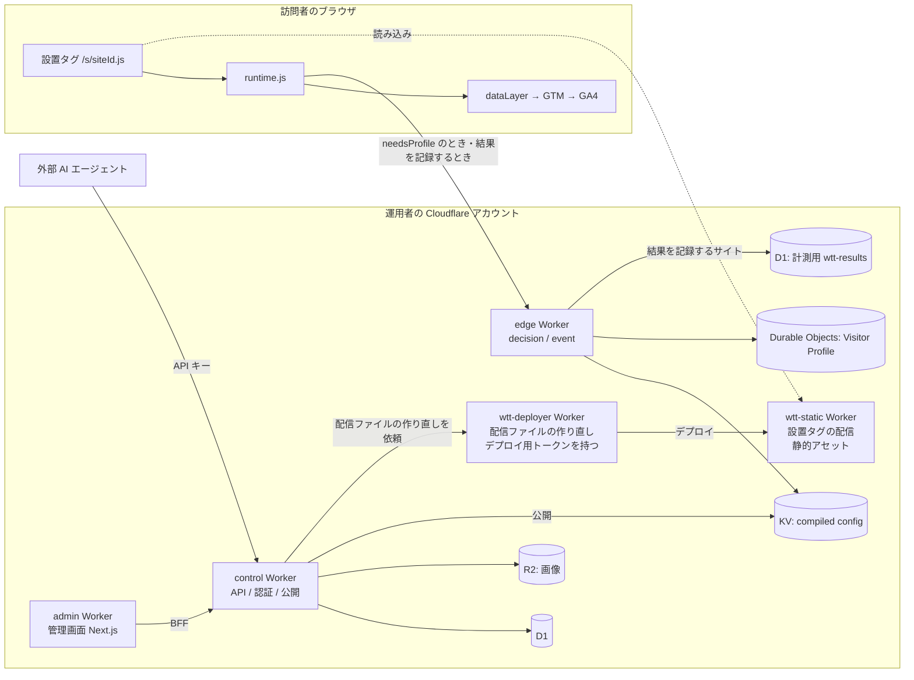

# AB Test and Target Harness

[](https://github.com/AnalyticsDesign/ab-test-and-target-harness/actions/workflows/ci.yml)

自分の Cloudflare アカウントにデプロイして使う、OSS の Web A/B テスト / パーソナライズツール。

| 役割 | どこで何をするか |
|---|---|
| 管理 | 管理画面(Cloudflare Workers 上で動く)で、エクスペリエンス(A/B テストまたはパーソナライズ)を作り、パターン・対象 URL・配信条件を決めて、開始・一時停止・終了する。 |
| 配信 | あなたのサイトに設置タグ(`<script>` 1 行)を置く。配信専用の Worker がこのタグを配り、edge Worker が、訪問者にどのパターンを見せるかを判定して返す。 |
| 計測 | パターンを見せたこと(露出)と目標の達成を `dataLayer` に push し、GTM 経由で GA4 に送る。結果は GA4 / BigQuery で読む。サイト設定で「結果を記録する」を有効にすると、本製品も参加と目標の達成を記録し、管理画面で判定を確認できる。 |

**現在の公開版は v1.0(2026-11-20 公開)。** すでに導入している場合は、[エージェントに任せる更新](#更新する)、または[デプロイガイドの更新の手順](docs/deploy.md#6-更新リリースタグ単位)で上げられる。今後の予定は[今後の予定と範囲外](#今後の予定と範囲外)の節、各版の変更は[変更履歴](CHANGELOG.md)を参照。使ってみた感想や不具合は Issue / Discussions へ。

> **Adobe 社および同社の旧製品 Test&Target とは無関係**である。名称の "Test and Target" は一般名詞としての用法で、Adobe との提携・後継・互換関係は一切ない。

目次: [できること](#できること) / [今後の予定と範囲外](#今後の予定と範囲外) / [構成図](#構成図) / [前提](#前提) / [導入](#導入) / [導入の流れ](#導入の流れ) / [開発](#開発)

## できること

- **A/B テスト**: 1 エクスペリエンスにつき 2 つ以上のパターン、重み配分、対象 URL(含める・除くのページを複数行で書き、各行に URL のパラメータの条件を足せる)、開始 / 一時停止 / 終了。ページの書き換えは TEXT / IMAGE / HIDE / ATTRIBUTE / HTML / CSS / CUSTOM_JS の 7 種
- **パーソナライズ**: 条件に合う訪問者全員に 1 つのパターンを見せるエクスペリエンス(振り分けない)。作成時に種別(テスト / パーソナライズ)を選ぶ。同じ要素を複数のエクスペリエンスが変えるときは、パーソナライズ → テスト(開始・再開の新しい順)の順に重ね、後に重ねた変更が優先される
- **エクスペリエンスの複製**: 同じ内容のまま、または選んだパターンだけを表示するパーソナライズとして複製できる
- **配信条件**: 次を組み合わせる。
  - 環境: 端末・ブラウザ・OS・画面の幅・リファラー(ページの URL・パス・ホスト・パラメータは対象 URL で指定する)
  - 時間: 曜日と時間帯、初回の訪問からの経過
  - 履歴: 閲覧したページ・目標の達成(期間も指定できる)。履歴は Durable Objects の Visitor Profile に持つ
  - オーディエンス: 名前を付けた条件。複数のエクスペリエンスで使える
- **目標**: PAGEVIEW / CLICK / CUSTOM の 3 種。一致したときに conversion イベントを出す
- **訪問者 ID のサブドメイン間の共有**: 同じ登録ドメインのホスト(例 `www` と申し込みフォームのサブドメイン)で同じ訪問者 ID を使い、別のホストでの目標の達成もテストの結果に入れられる。新しいサイトは既定でオン。サイト設定でオフにできる
- **GA4 への計測**: 露出(`ab_exposure`)と目標の達成(`ab_conversion`)を `dataLayer` に push し、GTM 経由で GA4 に送る。dataLayer の変数名はサイト設定で変えられる(既定 `dataLayer`)。集計と読み方は分析ガイドを参照
- **複数ユーザー運用**: ワークスペース単位のテナント、ロール 4 種(オーナー / 管理者 / 編集者 / 閲覧者)、招待リンク。本番化(公開 / 開始 / 一時停止 / 終了)は管理者以上
  - ログイン: 管理画面のログインは Google アカウント。招待されたメールアドレスだけが入れる(メール + パスワードは非常時にだけ開く)
  - システム管理者: 導入全体を管理する人。ワークスペースの作成・削除と、システム管理者を追加する・外す操作は、システム管理者だけが行う
  - 書き込みの凍結: 更新やデータベースの復旧の間、ログイン以外の変更操作を止める。訪問者への配信は止まらない
- **使用状況の表示**: Cloudflare の日次上限(Free の場合)に対する当日の消費と、上限に達する見込みを、管理画面のホームと設定で見られる(API は `GET /usage`)。表示には、読み取り専用の Cloudflare API トークンを置く(導入のときに作る)
- **テストの結果のレポート**(「結果を記録する」を有効にしたサイト): 開始の前に評価計画(判定に使う目標・期間・人数・判定の基準)を決め、開始の時点で固定する。実行中は速報として人数・CVR・基準を上回る確率を見られ、評価時点に判定(採用候補・悪化の可能性が高い・実務上ほぼ同等・判断材料が不足・データ品質の問題で判定不可)を 1 回だけ出して記録する。割り振りの偏り・混在・適用の失敗・収集の失敗を判定の前に確かめる。終了のときに採用したパターンを記録し、そのパターンだけを表示するパーソナライズの下書きを作れる。読み方は[テスト結果の読み方](docs/experiment-results.md)と、管理画面の「?」の説明にある
- **公開する内容の確認**: 公開と状態の変更の前に確認画面で内容(著者・時刻・「コードを含む」「外部の URL を含む」の印・同時に公開される変更)を確かめ、確かめた内容に操作を固定する(API は任意の `expectDigest`)
- **訪問者 ID の持ち方**: 訪問者を見分ける ID を誰が Cookie に書くかで、3 種ある。Mode A(JS Cookie)は設置タグが JavaScript で書く。Mode B(サーバー発行 Cookie)は edge Worker が `Set-Cookie` で発行し、Safari の 7 日の制限を受けない(サイトのドメインが Cloudflare のゾーンにあり、edge をそのゾーンに置く構成で、ページのホストに `/__ab/*` の Route を足したときだけ使える)。Mode C(BYOID)はサイトの既存の Cookie(会員 ID など)から ID を作る。迷ったら Mode A(JS Cookie)。違いは[サイト導入ガイド 8 節](docs/site-install.md#8-mode-c-と-mode-b)
- **タグを置くドメインの一覧**: サイトごとに、タグを置くドメインを 1 つの一覧(50 件まで)で持つ。受け付ける Origin と Cloudflare 経由のドメインは一覧から決まり、Mode B(サーバー発行 Cookie)のサイトでは保存のたびにドメインごとに edge が応答するかを確かめる
- **画像の一覧**(R2 を使う導入): サイトに上げた画像を縮小画像で一覧し、名前・大きさ・使っているパターンを見る。ドラッグ&ドロップでまとめてアップロードでき、パターンの IMAGE の変更では一覧から画像を選ぶ。使っていない画像は削除できる
- **操作の記録と変更履歴**: 人とアクセス権の操作と、サイト・エクスペリエンス・目標・オーディエンスの変更と公開を、誰が・いつ・どの方法で行ったかとともに要約で 365 日記録する。エクスペリエンスの「変更履歴」タブ(メンバー全員)と、設定の「操作の記録」(ワークスペースの管理者以上)で見られ、API キーでも読める
- **外部 AI エージェント向けの API**: OpenAPI 3.1(`GET /openapi.json`)、API キー、エージェント向けガイドの配布(`GET /llms.txt`)。エクスペリエンスの作成から公開、評価計画・結果の読み取り・終了と採用の記録、結果照会レシピの取得までを REST で完結できる

## 今後の予定と範囲外

### 今後の予定

機能の内容や公開する版は、変更になることがある。

- **ビジュアルエディタ**(画面上で要素を選んで書き換える編集モード)は v1.1。現状は CSS セレクタを手で指定する
- **MCP サーバ**は v1.1。当面は REST + OpenAPI を直接使う

### 製品の範囲外

- **AI によるパターン生成**: 本製品は LLM を呼ばない(生成は外部エージェントの仕事)

## 構成図

訪問者のブラウザでは設置タグが runtime.js を読み込み、`dataLayer` 経由で GA4 に計測を送る。そのほかの Worker はすべて運用者自身の Cloudflare アカウントに置く。



## 前提

- **Cloudflare アカウント**
  - ドメイン: 設置タグと edge を設置サイトと同じオリジンで配るには、そのサイトのドメインが Cloudflare のゾーンにあること。サイトのドメインが Cloudflare に無くても、別のドメインを Cloudflare に追加すれば、そのドメインのホストで設置タグと edge を配り、WAF とキャッシュを使える構成で導入できる(設置サイトとは別オリジンになり、Safari 対策の Mode B(サーバー発行 Cookie)は使えない)。ドメインを用意せずに `*.workers.dev` で公開する簡易的な構成も選べる(WAF・キャッシュ・Safari 対策が使えないなどの制約あり。Free が前提なので、評価のための導入に向く)。どれがよいかは、導入の対話での答えをもとに示される
  - R2(画像の置き場): 任意。使わなければ支払い方法の登録も不要
  - 構成の選び方は[導入構成の選び方](docs/install-patterns.md)を参照
- **GA4 プロパティと GTM コンテナ**: テストの結果を GA4 / BigQuery で読むときに要る(`dataLayer` から GTM 経由で GA4 に送る)。管理画面の結果のタブ(「結果を記録する」を有効にしたサイト)だけで読むなら、無くても判定は出る。本製品が保存するものは[法務](#法務)に書いてある
- **Node 24.22.3 以上の 24 系、または 26.13.1 以上の 26 系と pnpm 10 系**: Node の対応範囲は `engines.node`、pnpm の版は `packageManager` で指定。wrangler は `pnpm install` で入る

費用の目安は次のとおり(2026-11-16 確認、USD、ドメイン代・税別)。結果の記録と画像配信を使わず、目標の送信は 0.05 回/PV、新規 Profile は 0.1 件/PV、ピーク日は平均の 2 倍とした試算。無料枠内は Free、超える構成は Paid とし、管理操作・定期実行も見込む。料金と計算の前提は[導入構成の選び方 3 節](docs/install-patterns.md#3-料金プラン問い-2)にある。

| 月間 PV | 履歴条件・`persistAssignment` を使わない: Mode A(JS Cookie) / Mode C(BYOID) | Mode B(サーバー発行 Cookie)・履歴なし | 履歴条件・`persistAssignment` を使う(Mode を問わない) |
|---|---|---|---|
| 10 万 | $0 | $0 | $0 |
| 100 万 | $0 | $0 | 約 $5 |
| 1,000 万 | $0 | 約 $5 | 約 $7 |

- Mode A(JS Cookie) / Mode C(BYOID) で履歴条件などを使わず、結果の記録・画像配信も無ければ、PV に比例する Workers・DO・D1・KV・R2 の利用は無い(設置タグは無料の静的アセット)。導入全体の費用は、管理操作や定期実行、同じアカウントのほかの利用分にもよる
- Mode B(サーバー発行 Cookie)の判定は約 1 回/PV。Free の 10 万要求/日、Paid の 1,000 万要求/月から管理操作などの分を引いて考える。履歴条件などを使う場合の Free の約 4.7 万 PV/日は、Profile 更新だけで計算した上限で、予算確認・期限切れ削除などの分だけ下がる。上記の新規 Profile・削除の前提では、Paid の DO 要求の込み量は月約 80 万 PV で使い切る
- 結果の記録は別に見積もる。1 テストで参加の送信が 1/3 回/PV、CV の送信が 0.05 回/PV なら、Mode A(JS Cookie) / Mode C(BYOID)・履歴なしで約 0.38 回/PV が足される。履歴ありの CV や Mode B(サーバー発行 Cookie)のページ表示目標は既存の送信に便乗するため、同じ回数を足さない。記録の予算は Paid でも既定 7 万行/日。上記の 1 テスト・初回書込 2 行/件なら理論上約 9 万 PV/日だが、使い残しの枠や複数テストなどで早く止まる。予算に達した日は記録だけが止まり、配信は続く
- 別オリジンへの送信には CORS preflight、control 経由の画像には画像取得ごとの Worker と R2 の読み取りが加わる。履歴・画像・結果の保存量と CPU も別に確認する。表はこれらを含む請求額の保証ではない

Workers Free の CPU 時間の上限は 1 回 10 ms である。本製品は開発の段階で Worker の負荷が大きく、Free の制限に当たるおそれがある。2026-11 の実測では、管理画面のふつうの表示(エクスペリエンスの編集・公開の前の確認)も、ほぼ毎回 10 ms を超えていた(しばらく使わなかった後の最初の表示は、さらに大きい)。今は Cloudflare がこの超過で処理を止めていないので動いているが、上限が厳密に適用されると、管理画面が使えなくなりうる。そのため、Free での導入は評価のために使うことを勧める。安定して使うなら Workers Paid にする(ドメインなしの構成では、先にドメインを Cloudflare に追加する。[デプロイガイド 2.8](docs/deploy.md#28-ドメインありへの移行workers-dev--route))。

本製品には、費用の合計を見て自動で止める機能は無い。Cloudflare の [Workers の支出制限](https://developers.cloudflare.com/workers/platform/spend-management/)は要求・CPU の超過料金を対象にし、DO・D1・KV・R2 や月額最低額は対象外で、反映にも遅延がある。管理画面の「[使用状況](docs/operations.md#11-使用状況cloudflare-の上限)」も合わせて確認する。

## 導入

**試してみたい人は、Claude Code などの AI エージェントに下のプロンプトを貼るだけでよい。** Cloudflare に詳しくなくても進められる。

- やりたいこと(A/B テスト・Safari 対策など)と今の環境(Cloudflare のアカウント・ドメイン)を聞かれて答えると、推奨の構成と最も手軽な構成が、それぞれでできないことと一緒に示される(質問の一覧は[導入の質問](docs/install-questions.md))
- 構成の判断の根拠を知りたい人や手で導入する人は[導入構成の選び方](docs/install-patterns.md)へ

入り方は 3 つあり、上ほど手数が少ない。

1. [AI エージェントに任せる](#ai-エージェントに任せる推奨)(推奨)
2. [手で導入する](#手で導入する)
3. [開発する](#開発する)

### AI エージェントに任せる(推奨)

Claude Code / Codex などのコーディングエージェントに、下のプロンプトをそのまま貼る。エージェントが[デプロイガイド](docs/deploy.md)を読んで進める。

**事前に用意するもの**:

- 管理画面のログインに使う Google アカウント
- Cloudflare のアカウント(無ければ、導入の途中で作り方を案内される)
- ツールは不要(Git / Node / pnpm / jq は、足りなければエージェントが入れ方を示して入れる)

**進み方**(人が手を動かすのは、次の 5 か所だけ):

1. 足りないツールの導入の了承(最初に 1 回)
2. 質問への回答と構成の選択。やりたいことと今の環境を質問の表どおりに聞かれる(最大 10 問。分かっていればまとめて答えてよい)。答えると、推奨構成と最軽量構成が示されるので、どちらかを選ぶ。既存のアカウントに入れる答えでも、構成によっては新しいアカウントを作ることを勧められる。そのときは、構成の選択とは別にアカウントの変更への同意を聞かれる
3. Cloudflare アカウントの作成(要るときだけ)と `wrangler login` の許可
4. Cloudflare と Google の画面での設定(下の「ダッシュボードで人が用意するもの」。一度にまとめて頼まれる)
5. Google でのログインと画面での動作確認。最後に任意で、エージェントから操作するための API キーを発行する

**ダッシュボードで人が用意するもの**(エージェントが必要な値を埋めた依頼文で、最初に一度だけまとめて頼まれる。[デプロイガイド 0.5 節](docs/deploy.md#05-人に用意してもらうもの一度に集める)):

- Google の OAuth クライアント(画面ごとにエージェントが案内する)
- Cloudflare の API トークン。既存のアカウントでは、次の 3 通りから導入の質問で選ぶ(質問のときに、それぞれの違いも説明される)。新しく作る Cloudflare アカウントでは聞かず、(b) で進む
  - **(a) 管理者が Account API Token を 2〜3 本作る(おすすめ)**: 設置タグの配信ファイルのデプロイ用・使用状況の表示用(どちらも期限なし)と、必要なときのゾーンの設定用(期限 = 翌日。ドメインありの構成と、control か管理画面を自分のドメインに置くとき)を、管理者が直接作る。作ったトークンはアカウントに属するので、作った人がアカウントから外れても止まらない。既存のアカウントでおすすめなのは、(b) の親トークンの権限がそのアカウントのほかのサービスにも届くため
  - **(b) トークンを作るためのトークン(親トークン)を 1 本作る**: 親トークンは Account API Token(期限 = 翌日)。(a) と同じトークンはエージェントが親トークンから作り、使い終わった親トークンを消す。社内の規則で認められ、自分か管理者が作れるなら最も楽。作ったトークンはアカウントに属する
  - **(c) 自分の User API Token を作る(非推奨)**: 管理者の権限が無く、管理者にも頼めないときだけ、(a) と同じトークンを自分の User API Token で 2〜3 本作る。作った人がアカウントから外れると、デプロイと使用状況が止まる

#### 新規に導入する

```text
AB Test and Target Harness を私の Cloudflare アカウントに導入してください。
1. この PC に足りないツール(Git / Node 24.22.3 以上の 24 系、または 26.13.1 以上の 26 系 / Corepack / jq。Windows では Git for Windows(Git Bash・OpenSSL を含む)も)を確かめ、入れるもの(名前と入手元)の一覧を 1 回だけ示して了承を取ってから入れる。pnpm は Corepack で使う(Node 26 系などで Corepack が無ければ `npm install -g corepack` で入れる)。clone 後にリポジトリ直下で `corepack enable` を実行すると、リポジトリが固定した pnpm が使われる(docs/deploy.md 0.4)
2. https://github.com/AnalyticsDesign/ab-test-and-target-harness を短いパスに clone し(Windows では例 C:\wtth。長いパスでは Filename too long で失敗する。docs/deploy.md 0.4)、最新のリリースタグ(git tag の v* を版の順に並べた先頭。GitHub Releases の API は使わない)を checkout する
3. docs/install-questions.md を読み、その質問の表と進め方の規則どおりに私に聞く。答えは deploy-answers.example.yaml を写した deploy-answers.yaml に書く(既に deploy-answers.yaml があれば、答えの書かれた質問は飛ばす)
4. node tools/deploy-answers/cli.mjs を実行し、出力を要約せずにそのまま私に見せて、推奨構成と最軽量構成のどちらにするかを聞く。選んだら --accept recommended か --accept lightest を付けて実行する。出力の先頭に『確認: アカウントが変わる』が出て、選んだ構成がそれに当たるときは、その節をそのまま見せ、構成の選択とは別にアカウントの変更への同意を聞く。同意したときだけ --confirm-account-change を付ける(終了コードごとの扱いは docs/deploy.md 0.2)
5. docs/deploy.md を最初から最後まで読み、0 節の分担どおりに進める。コマンドは自分で実行し、【人が行う】と【人に依頼】の箇所でだけ止まって私に指示する
6. 各手順の「確認」を実行し、期待と違えば文書の分岐に従う。分岐に無い失敗は私に報告して止まる
7. 作業ログを deploy-log.md に残す。各手順の開始時刻(date -u)と結果を書き、秘密は書かない
8. 終わったら、入れたタグ・選んだ構成・control と管理画面の URL・作った workers.dev のサブドメイン(あれば)・エージェント向けの設定(.env.agent)を作ったか・残る鍵(CF_DEPLOY_TOKEN・CF_USAGE_TOKEN・発行した API キー)の保存場所と期限を一覧にして報告する
```

#### 更新する

導入時のフォルダが見つからない場合も、稼働中の Cloudflare の設定を確認して、新しい clone から更新できる。手順は[導入時のフォルダが無い場合](docs/deploy.md#導入時のフォルダが無い場合)を参照する。

```text
AB Test and Target Harness を更新してください。導入時の clone は <clone した場所。無ければ「なし」> です。稼働中の管理画面または control の URL は <分かる方の URL> です。
1. 既存の clone があれば git fetch --tags でリリースタグを取る。無ければ公開リポジトリを新規 clone し、目標タグの docs/deploy.md 6 節の「導入時のフォルダが無い場合」に従う。稼働中のタグと目標のタグを根拠とともに私に示す。稼働中のタグが特定できなければ更新を止める
2. 目標タグの docs/deploy.md の 6 節(git show <目標タグ>:docs/deploy.md)を読む。更新手順は常に目標タグのものに従う
3. CHANGELOG.md(目標タグのもの)でその間の変更(マイグレーション・サイト設定のフィールド追加・runtime の変更)を要約して私に示し、進めてよいか確認する
4. 6 節の順序どおりに更新し、各「確認」を実行する。【人が行う】と【人に依頼】の箇所では止まって私に指示する
5. deploy-log.md に更新の記録を追記し、結果を報告する
```

### 手で導入する

[デプロイガイドの「手で導入する最短の手順」](docs/deploy.md#手で導入する最短の手順)を上から順に進める(既定の構成を 18 手順で動かす)。構成を変えたい項目は、0.1 節の表から該当する節へ。

### 開発する

`git clone` して[開発](#開発)の節を見る。

## 導入の流れ

導入から運用までに読む文書を、順に並べる。

| 順 | 文書 | 内容 |
|---|---|---|
| 1 | [デプロイガイド](docs/deploy.md)(エージェントに任せる場合は[導入](#導入)) | edge / control / admin(と設置タグの配信用の 2 つの Worker)を自分の Cloudflare アカウントに置き、初回セットアップを済ませる |
| 2 | [サイト導入ガイド](docs/site-install.md) | 対象サイトにタグを入れ、consent と GA4 / GTM の受け側を配線する |
| 3 | [運用ガイド](docs/operations.md) | エクスペリエンスを作り、下書きを確認し、公開 / 開始して様子を見る |
| 4 | [分析ガイド](docs/analytics.md) | GA4 の探索レポートまたは BigQuery で結果を読む |
| 5 | [エージェント向けガイド](docs/agent-guide.md) | 外部 AI エージェントに操作させる場合。control が `GET /llms.txt` で同じ内容を配る |

用語は [CONTEXT.md](CONTEXT.md) にまとめてある。文書の一覧は [docs/README.md](docs/README.md)。

## 法務

本製品は、次を運用者自身の Cloudflare アカウントに保存する。

- 設定とユーザー(D1 の `wtt-control`)
- 画像(R2。使う場合)
- 訪問者ごとの履歴(Durable Objects の Visitor Profile。履歴の条件を使うときに作る)。訪問者の識別子、閲覧したページの回数と最終日時、目標の達成回数、割り当てたパターンを持つ。生のイベントは保存せず、最終訪問から `retentionDays` で消える
- テストの参加者ごとの記録(D1 の `wtt-results`。サイト設定の「結果を記録する」が有効なサイトだけ)。テストごとに、表示したパターン・端末の種類・変更の適用の状態・最初の参加の時刻と、目標を最初に達成した時刻を持つ。訪問者の識別子はそのまま保存せず、鍵付きのハッシュにする。テストの記録を終えた時点から、サイト設定の保持期間(既定 90 日)を過ぎた後、書き込みの予算に余裕のある日に消す。同意の撤回でも消す(`forgetOnRevoke` が on のとき)
- テストの評価計画・固定した結果(パターンごとの人数・CV の数・判定などの集計。訪問者ごとの記録は含まない)・採用の記録(D1 の `wtt-control`)。参加者ごとの記録を消した後も残る

「結果を記録する」が無効のサイトでは、テストの結果に関わるものは保存しない。訪問者の識別子と行動履歴は `dataLayer` 経由で GA4 に送る。外部送信規律など各種規律への対応は運用者が行う。公表用の情報一覧の材料は [サイト導入ガイド「14. 外部送信規律への対応」](docs/site-install.md#14-外部送信規律への対応)にまとめてある。

## 開発

```bash
pnpm install       # 依存の導入(Node 24.22.3 以上の 24 系、または 26.13.1 以上の 26 系)
pnpm test          # 単体テスト(全パッケージ)
pnpm e2e           # E2E(sample-site + wrangler dev + Playwright)
pnpm e2e:admin     # 管理画面の E2E
pnpm e2e:admin -- leave-guard.spec.ts   # 1 ファイルだけ(pnpm e2e も同じ形。先に流れる前提のテストがあれば、それも一緒に流れる)
pnpm typecheck     # 型チェック(全パッケージ)
pnpm docs:check    # 文書のリンク・パス検査
```

Windows on ARM(ARM64)では、ローカル実行に使う workerd が動かない(`pnpm install` で警告が出る)。Cloudflare への導入(deploy)はできるが、workerd を使う `wrangler dev`・E2E・control / edge の単体テストは動かない。開発は macOS / Linux / x64 の Windows で行う。

### ディレクトリ

| パス | 内容 |
|---|---|
| `apps/edge` | データプレーンの Worker(decision / event) |
| `apps/deployer` | デプロイ専用の Worker(設置タグの配信ファイルを作り直して、配信専用の Worker `wtt-static` に入れる。トークンを持つのはこの Worker だけ) |
| `apps/control` | コントロールプレーンの Worker(API / 認証 / 公開) |
| `apps/admin` | 管理画面(Next.js。Cloudflare Workers に vinext で配置) |
| `packages/core` | スキーマ・compile・ターゲティング評価の共有ロジック |
| `packages/runtime` | ブラウザで動く runtime.js |
| `packages/sample-site` | E2E 用のサンプルサイトと Playwright テスト |
| `tools/fixture` | ローカル / E2E 用の config 生成 CLI |
| `tools/docs-check.mjs` | 文書のリンク・パス検査(`pnpm docs:check`) |
| `fixtures/` | その入力 JSON |
| `integrations/gtm` | GTM にインポートする設定(変数・トリガー・GA4 イベントタグ。[サイト導入ガイド 4.3](docs/site-install.md#43-ショートカット-json-をインポートする)) |
| `docs/` | 本ガイド一式 |

ソースコードのコメントやテスト名に出てくる「決定 N」「Plan N」や spec の節番号は、開発時の非公開の設計記録への参照で、このリポジトリでは参照先を提供しない。挙動の根拠は各ガイドの本文に書いてある。

## 投稿

不具合の報告と機能の提案は Issue、使い方の質問は Discussions で受け付ける。Pull Request は提案として受け、採用したものは次のリリースに取り込む(このリポジトリで直接マージはしない)。詳しくは [CONTRIBUTING.md](CONTRIBUTING.md)、脆弱性の報告は [SECURITY.md](SECURITY.md)。

## ライセンス

MIT License。全文は [LICENSE](LICENSE) を参照。
