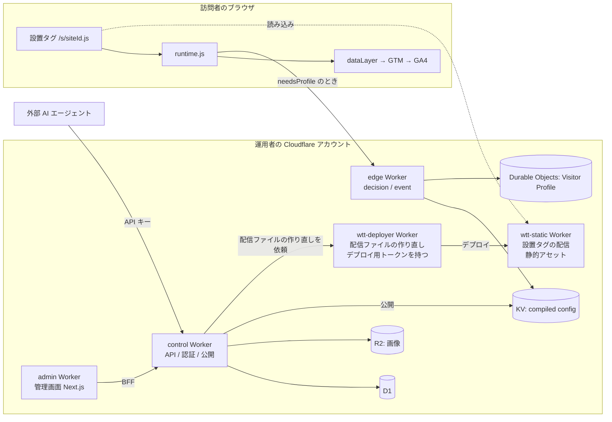

# Web Test and Target Harness

自分の Cloudflare アカウントにデプロイして使う、OSS の Web A/B テスト / パーソナライズツール。役割は 3 つに分かれている。

- 管理: エクスペリエンスの作成と運用は、管理画面(Cloudflare Workers)で行う
- 配信: 設置タグを配る配信専用の Worker と、判定を返す edge Worker が担う
- 計測: テストの結果(露出・目標の達成)は `dataLayer` から GA4 に送り、GA4 / BigQuery で読む。本製品は結果の集計を持たない

状態: v0.9(先行公開版)。v1.0 で追加する予定の機能は[まだできないこと](#まだできないこと)にある。v0.9 から v1.0 へは更新で上げられる。使ってみた感想や不具合は Issue / Discussions へ。変更履歴は [CHANGELOG.md](CHANGELOG.md)

> **Adobe 社および同社の旧製品 Test&Target とは無関係**である。名称の "Test and Target" は一般名詞としての用法で、Adobe との提携・後継・互換関係は一切ない。

目次: [できること](#できること) / [まだできないこと](#まだできないこと) / [構成図](#構成図) / [前提](#前提) / [導入](#導入) / [導入の流れ](#導入の流れ) / [開発](#開発)

## できること

- **A/B テスト**: 1 エクスペリエンスにつき 2 つ以上のパターン、重み配分、URL マッチ、開始 / 一時停止 / 終了。ページの書き換えは TEXT / IMAGE / HIDE / ATTRIBUTE / HTML / CSS / CUSTOM_JS の 7 種
- **配信条件**: 次を組み合わせる。
  - ページと環境: URL・パス・ホスト・クエリ・端末・ブラウザ・OS・画面の幅・リファラー
  - 時間: 曜日と時間帯、初回の訪問からの経過
  - 履歴: 閲覧したページ・目標の達成(期間も指定できる)。履歴は Durable Objects の Visitor Profile に持つ
  - オーディエンス: 名前を付けた条件。複数のエクスペリエンスで使える
- **目標**: PAGEVIEW / CLICK / CUSTOM の 3 種。一致したときに conversion イベントを出す
- **GA4 への計測**: 露出(`ab_exposure`)と目標の達成(`ab_conversion`)を `dataLayer` に push し、GTM 経由で GA4 に送る。集計と読み方は分析ガイドを参照
- **複数ユーザー運用**: ワークスペース単位のテナント、ロール 4 種(オーナー / 管理者 / 編集者 / 閲覧者)、招待リンク。本番化(公開 / 開始 / 一時停止 / 終了)は管理者以上
  - ログイン: 管理画面のログインは Google アカウント。招待されたメールアドレスだけが入れる(メール + パスワードは非常時にだけ開く)
  - システム管理者: 導入全体を管理する人。ワークスペースの作成・削除とシステム管理者の追加・外すは、システム管理者だけが行う
  - 書き込みの凍結: 更新やデータベースの復旧の間、ログイン以外の変更操作を止める。訪問者への配信は止まらない
- **使用状況の表示**: Cloudflare の日次上限(Free の場合)に対する当日の消費と、上限に達する見込みを、管理画面のホームと設定で見られる(API は `GET /usage`)。表示には、読み取り専用の Cloudflare API トークンを置く(導入のときに作る)
- **外部 AI エージェント向けの API**: OpenAPI 3.1(`GET /openapi.json`)、API キー、エージェント向けガイドの配布(`GET /llms.txt`)。エクスペリエンスの作成から公開、結果照会レシピの取得までを REST で完結できる

## まだできないこと

v1.0 で追加する予定:

- **テストの結果のレポート**: v0.9 は統計的な有意差判定・SRM 検知・管理画面内の結果の画面を持たない。数値は GA4 / BigQuery 側で見る。v1.0 で、勝つ確率・SRM 検知・採用したパターンの記録を管理画面に追加する予定
- **パーソナライズ**: 条件に合う訪問者に 1 つのパターンだけを見せるエクスペリエンス。v0.9 のエクスペリエンスは A/B テストだけ
- **使用状況の履歴**: v0.9 は当日の消費と上限に達する見込みだけを出し、過去の推移は残さない

その後の予定:

- **ビジュアルエディタ**(画面上で要素を選んで書き換える編集モード)は v1.1。現状は CSS セレクタを手で指定する
- **MCP サーバ**は v1.1。当面は REST + OpenAPI を直接使う
- **Mode B(First-party Bridge)**: サイト自身のサーバーを経由して Cookie を発行する構成は Phase 2。ITP 対策としては同一ゾーンの Workers Route を使う D-lite を用意している

製品の範囲外:

- **AI によるパターン生成**: 本製品は LLM を呼ばない(生成は外部エージェントの仕事)

## 構成図

訪問者のブラウザでは設置タグが runtime.js を読み込み、`dataLayer` 経由で GA4 に計測を送る。そのほかの Worker はすべて運用者自身の Cloudflare アカウントに置く。



## 前提

- **Cloudflare アカウント**
  - ドメイン: 設置タグと edge を設置サイトと同じオリジンで配るには、そのサイトのドメインが Cloudflare のゾーンにあること。ドメインを用意せずに `*.workers.dev` で公開する簡易的な構成も選べる(WAF・キャッシュ・Safari 対策が使えないなどの制約あり)。どちらがよいかは導入の対話で答えから示される
  - R2(画像の置き場): 任意。使わなければ支払い方法の登録も不要
  - 構成の選び方は[導入構成の選び方](docs/install-patterns.md)を参照
- **GA4 プロパティと GTM コンテナ**: テストの結果は `dataLayer` から GTM 経由で GA4 に送って読む。本製品は結果の集計を持たないので、結果を見るには GA4 と GTM が要る。本製品が保存するものは[法務](#法務)に書いてある
- **Node 24 以上と pnpm 10 系**: `packageManager` で固定。wrangler は `pnpm install` で入る

費用の目安は次のとおり。プランの選び方は[導入構成の選び方 3 節](docs/install-patterns.md#3-料金プラン問い-2)にある。

| 月間 PV | 費用 |
|---|---|
| 100k | $0(Cloudflare 無料枠内) |
| 1M | 約 $5 |
| 10M | 約 $10〜13 |

Workers Free には 100k リクエスト / 日の上限があるので、日次のピークに注意する。

## 導入

**試してみたい人は、Claude Code などの AI エージェントに下のプロンプトを貼るだけでよい。** Cloudflare に詳しくなくても進められる。

- やりたいこと(A/B テスト・Safari 対策など)と今の環境(Cloudflare のアカウント・ドメイン)を聞かれて答えると、推奨の構成と最も手軽な構成が、それぞれでできないことと一緒に示される(質問の一覧は[導入の質問](docs/install-questions.md))
- 構成の判断の根拠を知りたい人や手で導入する人は[導入構成の選び方](docs/install-patterns.md)へ

入り方は 3 つあり、上ほど手数が少ない。

1. [AI エージェントに任せる](#ai-エージェントに任せる推奨)(推奨)
2. [手で導入する](#手で導入する)
3. [開発する](#開発する)

### AI エージェントに任せる(推奨)

Claude Code / Codex などのコーディングエージェントに、下のプロンプトをそのまま貼る。エージェントが[デプロイガイド](docs/deploy.md)を読んで進める。

**事前に用意するもの**:

- 管理画面のログインに使う Google アカウント
- Cloudflare のアカウント(無ければ、導入の途中で作り方を案内される)
- ツールは不要(Git / Node / pnpm / jq は、足りなければエージェントが入れ方を示して入れる)

**進み方**(人が手を動かすのは、次の 5 か所だけ):

1. 足りないツールの導入の了承(最初に 1 回)
2. 質問への回答と構成の選択。やりたいことと今の環境を質問の表どおりに聞かれる(最大 9 問。分かっていればまとめて答えてよい)。答えると、推奨構成と最軽量構成が示されるので、どちらかを選ぶ。既存のアカウントに入れる答えでも、構成によっては新しいアカウントを作ることを勧められる。そのときは、構成の選択とは別にアカウントの変更への同意を聞かれる
3. Cloudflare アカウントの作成(要るときだけ)と `wrangler login` の許可
4. Cloudflare と Google の画面での設定(下の「ダッシュボードで人が用意するもの」。一度にまとめて頼まれる)
5. Google でのログインと画面での動作確認。最後に任意で、エージェントから操作するための API キーを発行する

**ダッシュボードで人が用意するもの**(エージェントが必要な値を埋めた依頼文で、最初に一度だけまとめて頼まれる。[デプロイガイド 0.5 節](docs/deploy.md#05-人に用意してもらうもの一度に集める)):

- Google の OAuth クライアント(画面ごとにエージェントが案内する)
- Cloudflare の API トークン 2 本(設置タグの配信ファイルのデプロイ用・使用状況の表示用。どちらも期限なし)。ドメインありの構成ではもう 1 本(ゾーンの設定用、期限 = 翌日)

#### 新規に導入する

```text
Web Test and Target Harness を私の Cloudflare アカウントに導入してください。
1. この PC に足りないツール(Git / Node 24 以上の LTS / pnpm / jq。Windows では Git for Windows(Git Bash・OpenSSL を含む)も)を確かめ、入れるもの(名前と入手元)の一覧を 1 回だけ示して了承を取ってから入れる。pnpm は単体で入れず、Node に付く Corepack で使う(clone の後、リポジトリが固定した版が使われる。docs/deploy.md 0.4)
2. https://github.com/AnalyticsDesign/web-test-and-target-harness を clone し、最新のリリースタグ(git tag の v* を版の順に並べた先頭。GitHub Releases の API は使わない)を checkout する
3. docs/install-questions.md を読み、その質問の表と進め方の規則どおりに私に聞く。答えは deploy-answers.example.yaml を写した deploy-answers.yaml に書く(既に deploy-answers.yaml があれば、答えの書かれた質問は飛ばす)
4. node tools/deploy-answers/cli.mjs を実行し、出力を要約せずにそのまま私に見せて、推奨構成と最軽量構成のどちらにするかを聞く。選んだら --accept recommended か --accept lightest を付けて実行する。出力の先頭に『確認: アカウントが変わる』が出て、選んだ構成がそれに当たるときは、その節をそのまま見せ、構成の選択とは別にアカウントの変更への同意を聞く。同意したときだけ --confirm-account-change を付ける(終了コードごとの扱いは docs/deploy.md 0.2)
5. docs/deploy.md を最初から最後まで読み、0 節の分担どおりに進める。コマンドは自分で実行し、【人が行う】と【人に依頼】の箇所でだけ止まって私に指示する
6. 各手順の「確認」を実行し、期待と違えば文書の分岐に従う。分岐に無い失敗は私に報告して止まる
7. 作業ログを deploy-log.md に残す。各手順の開始時刻(date -u)と結果を書き、秘密は書かない
8. 終わったら、入れたタグ・選んだ構成・control と管理画面の URL・作った workers.dev のサブドメイン(あれば)・エージェント向けの設定(.env.agent)を作ったか・残る鍵(CF_DEPLOY_TOKEN・CF_USAGE_TOKEN・発行した API キー)の保存場所と期限を一覧にして報告する
```

#### 更新する

```text
Web Test and Target Harness を更新してください。作業ディレクトリは <clone した場所> です。
1. git fetch --tags で最新のリリースタグを取り、現在のタグ(git describe --tags --exact-match)と目標のタグを私に示す
2. 目標タグの docs/deploy.md の 6 節(git show <目標タグ>:docs/deploy.md)を読む。更新手順は常に目標タグのものに従う
3. CHANGELOG.md(目標タグのもの)でその間の変更(マイグレーション・サイト設定のフィールド追加・runtime の変更)を要約して私に示し、進めてよいか確認する
4. 6 節の順序どおりに更新し、各「確認」を実行する。【人が行う】と【人に依頼】の箇所では止まって私に指示する
5. deploy-log.md に更新の記録を追記し、結果を報告する
```

### 手で導入する

[デプロイガイドの「手で導入する最短の手順」](docs/deploy.md#手で導入する最短の手順)を上から順に進める(既定の構成を 18 手順で動かす)。構成を変えたい項目は、0.1 節の表から該当する節へ。

### 開発する

`git clone` して[開発](#開発)の節を見る。

## 導入の流れ

導入から運用までに読む文書を、順に並べる。

| 順 | 文書 | 内容 |
|---|---|---|
| 1 | [デプロイガイド](docs/deploy.md)(エージェントに任せる場合は[導入](#導入)) | edge / control / admin(と設置タグの配信用の 2 つの Worker)を自分の Cloudflare アカウントに置き、初回セットアップを済ませる |
| 2 | [サイト導入ガイド](docs/site-install.md) | 対象サイトにタグを入れ、consent と GA4 / GTM の受け側を配線する |
| 3 | [運用ガイド](docs/operations.md) | エクスペリエンスを作り、下書きを確認し、公開 / 開始して様子を見る |
| 4 | [分析ガイド](docs/analytics.md) | GA4 の探索レポートまたは BigQuery で結果を読む |
| 5 | [エージェント向けガイド](docs/agent-guide.md) | 外部 AI エージェントに操作させる場合。control が `GET /llms.txt` で同じ内容を配る |

用語は [CONTEXT.md](CONTEXT.md) にまとめてある。文書の一覧は [docs/README.md](docs/README.md)。

## 法務

本製品は、次を運用者自身の Cloudflare アカウントに保存する。

- 設定とユーザー(D1)
- 画像(R2。使う場合)
- 訪問者ごとの履歴(Durable Objects の Visitor Profile。履歴の条件を使うときに作る)。訪問者の識別子、閲覧したページの回数と最終日時、目標の達成回数、割り当てたパターンを持つ。生のイベントは保存せず、最終訪問から `retentionDays` で消える

テストの結果の集計は保存しない。訪問者の識別子と行動履歴は `dataLayer` 経由で GA4 に送る。外部送信規律など各種規律への対応は運用者が行う。公表用の情報一覧の材料は [サイト導入ガイド「14. 外部送信規律への対応」](docs/site-install.md#14-外部送信規律への対応)にまとめてある。

## 開発

```bash
pnpm install       # 依存の導入(Node 24 以上)
pnpm test          # 単体テスト(全パッケージ)
pnpm e2e           # E2E(sample-site + wrangler dev + Playwright)
pnpm e2e:admin     # 管理画面の E2E
pnpm typecheck     # 型チェック(全パッケージ)
pnpm docs:check    # 文書のリンク・パス検査
```

Windows on ARM(ARM64)では、ローカル実行に使う workerd が動かない(`pnpm install` で警告が出る)。Cloudflare への導入(deploy)はできるが、workerd を使う `wrangler dev`・E2E・control / edge の単体テストは動かない。開発は macOS / Linux / x64 の Windows で行う。

### ディレクトリ

| パス | 内容 |
|---|---|
| `apps/edge` | データプレーンの Worker(decision / event) |
| `apps/deployer` | デプロイ専用の Worker(設置タグの配信ファイルを作り直して、配信専用の Worker `wtt-static` に入れる。トークンを持つのはこの Worker だけ) |
| `apps/control` | コントロールプレーンの Worker(API / 認証 / 公開) |
| `apps/admin` | 管理画面(Next.js。Cloudflare Workers に vinext で配置) |
| `packages/core` | スキーマ・compile・ターゲティング評価の共有ロジック |
| `packages/runtime` | ブラウザで動く runtime.js |
| `packages/sample-site` | E2E 用のサンプルサイトと Playwright テスト |
| `tools/fixture` | ローカル / E2E 用の config 生成 CLI |
| `tools/docs-check.mjs` | 文書のリンク・パス検査(`pnpm docs:check`) |
| `fixtures/` | その入力 JSON |
| `integrations/gtm` | GTM にインポートする設定(変数・トリガー・GA4 イベントタグ。[サイト導入ガイド 4.3](docs/site-install.md#43-ショートカット-json-をインポートする)) |
| `docs/` | 本ガイド一式 |

ソースコードのコメントやテスト名に出てくる「決定 N」「Plan N」や spec の節番号は、開発時の非公開の設計記録への参照で、このリポジトリでは参照先を提供しない。挙動の根拠は各ガイドの本文に書いてある。

## 投稿

不具合の報告と機能の提案は Issue、使い方の質問は Discussions で受け付ける。Pull Request は提案として受け、採用分は次のリリースに取り込む(このリポジトリで直接マージはしない)。詳しくは [CONTRIBUTING.md](CONTRIBUTING.md)、脆弱性の報告は [SECURITY.md](SECURITY.md)。

## ライセンス

MIT License。全文は [LICENSE](LICENSE) を参照。
